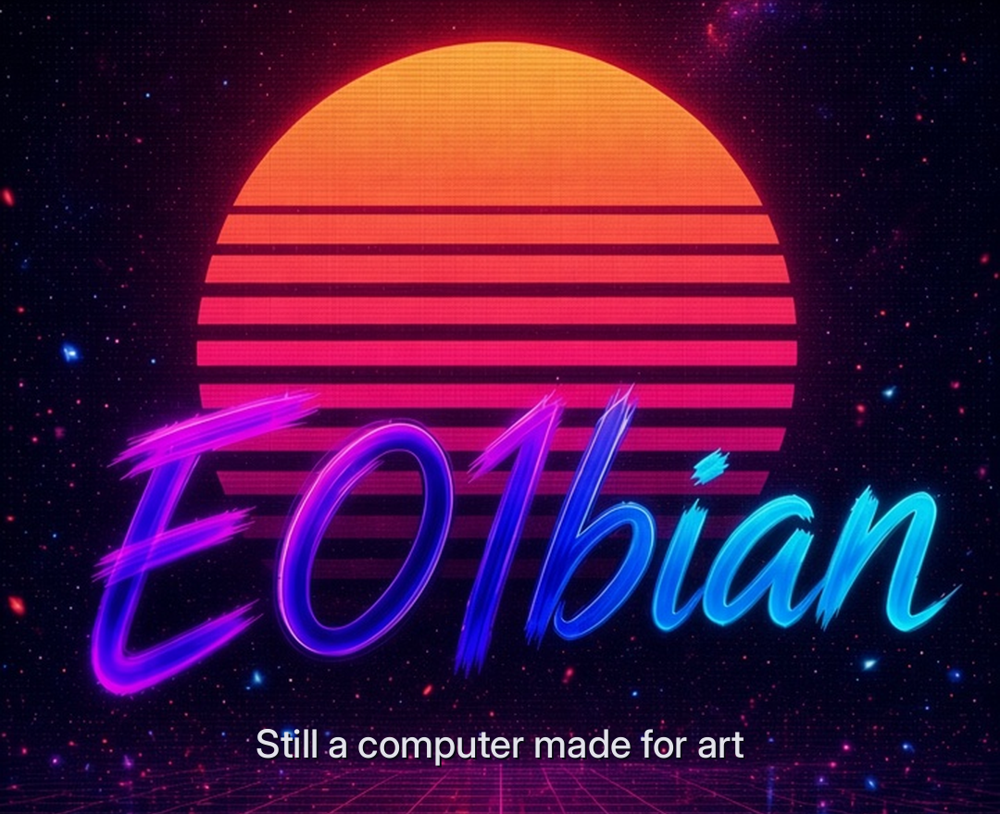
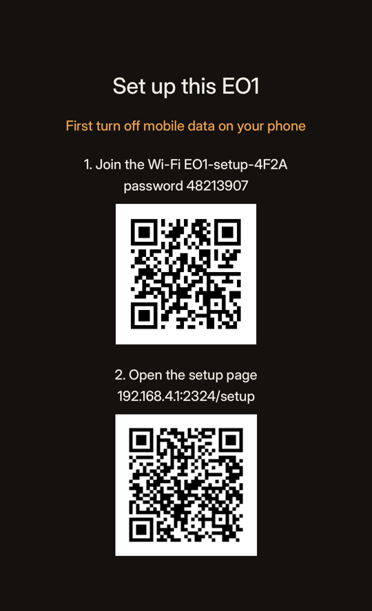
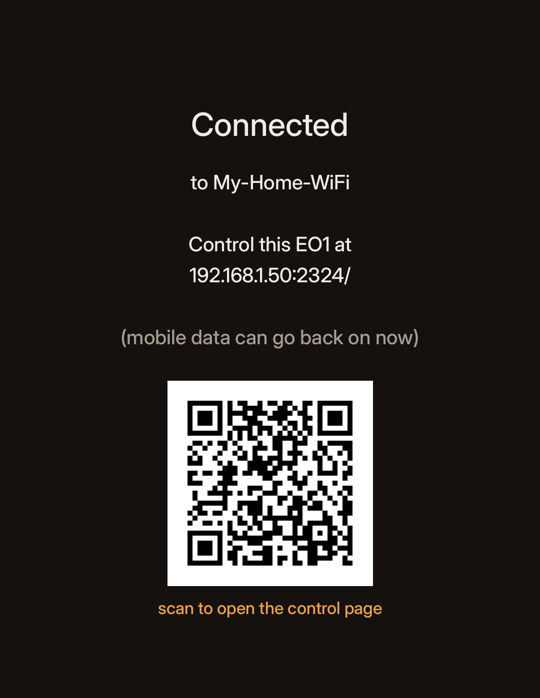
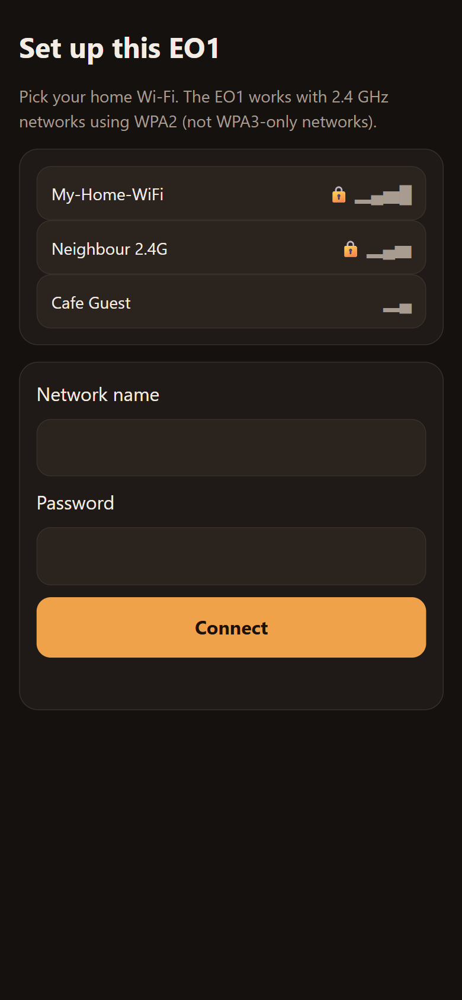
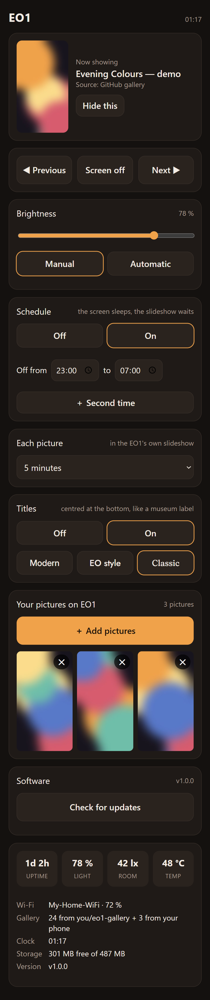
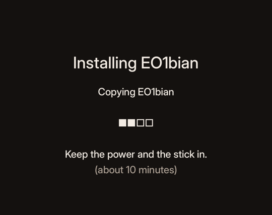
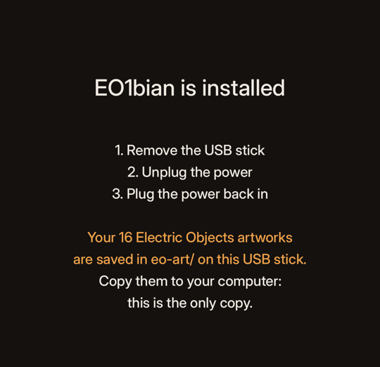

<p align="center"></p>

# EO1bian

**A new life for the Electric Objects EO1. *Still a computer made for art.***

The Electric Objects EO1 was a beautiful digital art frame that only worked with its maker's cloud. Electric
Objects was bought by Giphy in 2017, and the cloud service went offline in June 2023. Since then thousands of
working frames have been stuck: no art, no setup, no app - well-made hardware on its way to becoming e-waste.

EO1bian is a revival for these abandoned frames. It replaces the EO1's old Android 4.4 with a small, fast Debian
system made for one thing: showing your pictures and videos beautifully. It is built from scratch - not a line
of the original Android app or its cloud is reused - and there is no company server that can go dark and take
your frame with it again. No cloud, no account, no subscription.

> EO1bian is a community project based on Debian. It is not made by, affiliated with or endorsed by Electric
> Objects, Giphy or the Debian project; "Electric Objects" and "EO1" only name the hardware it runs on, and
> Debian is a registered trademark of Software in the Public Interest, Inc. All other names (NXP, Tailscale,
> ntfy, GitHub, ...) are trademarks of their respective owners.

## FAQ

**Can this brick my EO1?**
Nope. The chip that starts the EO1 is never written to, and the EO1 always looks for a USB stick first - so
the stick that got you into this can always get you out. Android stays on the frame, untouched.

**Will my original Electric Objects art disappear?**
Nope. Before anything is installed, the art still on your frame is saved to the stick (the `eo-art/` folder) -
and if it cannot be saved, the installer refuses to run. Copy that folder to your computer afterwards: it may
be the only copy in the world.

**Does it rely on cloud services?**
Nope. Everything is stored on the frame itself: pictures you send from your phone stay there and play without
internet. The cloud-era conveniences are rebuilt so that you own them: the optional gallery lives in your own
GitHub account, and the optional live remote talks through a free ntfy relay (ntfy.zap.pm, or ntfy.sh or your
own if you prefer), which only ever sees encrypted bytes ([SECURITY.md](SECURITY.md)). No account is needed to use the frame, there is nothing to pay,
and there is no company server that can go dark and take your frame with it - that already happened once.

**Why Debian, and not the EO1's own Android?**
Android 4.4 from 2014 is frozen, slow to start and full of parts a frame never uses; Debian is maintained,
starts straight into your pictures, and lets the frame do exactly what you want - locally, from your own
GitHub, live from your phone - with no old APIs or cloud in the way. More in [Why Debian](#why-debian).
Android itself stays on the frame, untouched.

**How much room is there for pictures?**
About 500 MB on the EO1 itself - a few hundred pictures, or fewer pictures plus some short videos (a GitHub
gallery is copied into the same space, so the frame keeps playing without internet). The control page shows
how much is free. Making more room is next on the list: the system has space to spare that can go to your
pictures.

**Do I have to root it, enable developer mode or use adb?**
Nope. Stick in, power on. The EO1 does the rest and talks to you with QR codes on its screen.

**Is any of the old Electric Objects software in this?**
Nope. EO1bian is built from scratch: no code from the original Android app or the Electric Objects cloud is
reused. The only thing it touches from the old system is your art, which it saves for you.

**Doesn't the video decoder need licensed firmware?**
Yes, and it is handled the honest way: NXP's VPU firmware is not redistributable, so it is **not** in
EO1bian's downloads. At every start your EO1 copies that one file from its own Android partition - the copy
Electric Objects licensed and shipped with your frame - and it never leaves the device. Please don't ask for
the file: it cannot be shared, and your EO1 already has it ([THIRD-PARTY.md](THIRD-PARTY.md)).

**Is it hard to set up?**
Nope. No keyboard, no mouse, no computer skills, no opening the frame: unpack a ZIP onto a USB stick, plug it
in, scan two QR codes, type your Wi-Fi password. That's the whole setup.

**Do I have to leave the stick in?**
Only until you tap **Install** on the control page (recommended, about 10 minutes): EO1bian moves into the
EO1's own memory and the stick is yours again - copy `eo-art/` off it first.

**Can I see it and control it away from home?**
Yep. Pair your phone once and see live what your EO1 is showing - change picture, brightness and albums from
anywhere, on mobile data too. No account, no app, no server of yours, encrypted end to end.

**What if something goes wrong anyway?**
Put the stick back in and plug the power: the EO1 starts from the stick again, every time. That is the whole
recovery story.

## What you need

- A USB stick of 4 GB or more, and one of these to plug it into the EO1 (the EO1 only has a **micro-USB** port):
  - **a micro-USB to USB-A adapter** ("micro-USB OTG adapter", a few dollars): the micro-USB end goes into the
    EO1, your regular USB stick into the other end. This is what we test with.
  - **or a stick with a micro-USB plug of its own**, such as the **SanDisk Ultra Dual Drive m3.0** (it has both a
    micro-USB and a regular USB-A end): put EO1bian on it through the USB-A end, then plug the micro-USB end into
    the EO1. Make sure it is the micro-USB model, not a USB-C one.
- A computer (Windows, Mac or Linux) for a few minutes, once: to download EO1bian and unpack it onto the stick
- A phone, and the name and password of your home Wi-Fi (2.4 GHz, WPA2)

That's all: no keyboard, no mouse, no computer at the frame, no opening the back. This is the most straightforward
setup we could make for a frame that has only a micro-USB port and one touch button on top.

## Set it up

1. **Put EO1bian on the stick.** From the releases, download `eo1bian-<version>.zip` and unpack it onto the
   stick: that's all, no special program. Two things matter: the stick must be **FAT32** (most sticks of 32 GB or
   less already are; if not, format it as FAT32 first), and the files (`6x_bootscript`, `rootfs.img`, ...) must
   be **in the root of the stick, not in a folder**: when you open the stick you should see `rootfs.img`,
   `eo1.txt` and the folders `patches`, `state`, `logs` and `ssh` right away (for example `E:
ootfs.img`, not
   `E:\eo1bian-v1.0.0
ootfs.img`). Windows' "Extract All" suggests a folder: remove that part of the path. Or, if you prefer, write `eo1bian-<version>.img.xz` with [balenaEtcher](https://etcher.balena.io/)
   or Rufus.
2. **Plug it in.** Put the stick in the EO1's micro-USB port (with the adapter), then connect the power.
   The screen stays black for a few seconds, then shows the **EO1bian logo** while it starts from the stick
   (about 15 seconds to the logo and up to 30 seconds in all with an ordinary USB stick - the EO1 reads a stick
   slowly; once installed it starts much faster). The internal memory is not changed.
3. **Turn off mobile data on your phone** (4G/5G) for the setup. The EO1's setup Wi-Fi has no internet, so a phone
   with mobile data on keeps using that and never reaches the setup page. If the phone asks whether to stay on a
   Wi-Fi without internet, say yes. Turn mobile data back on when the EO1 says "Connected".
4. **Scan the QR codes** - two on the first screen, then one more on the next. That is the whole setup:

   | | |
   |---|---|
   |  | **First screen - two QR codes.**<br><br>**QR code 1** joins your phone to the EO1's own setup Wi-Fi (*EO1-setup-XXXX*; the password is on the screen too).<br><br>**QR code 2** opens the setup page. Pick your home Wi-Fi (**SSID**) and type its **password**, so the EO1 can join your home network. |
   |  | **Next screen - one QR code.**<br><br>The EO1 joins your Wi-Fi and the screen changes to this one. **QR code 3**: Scan it to open the **control page** - you are fully connected. Add it to your phone's home screen to use it like an app. |

   The setup page on your phone (after QR code 2) and the control page (after QR code 3):

   <p align="center"> &nbsp; </p>

5. **Install it (recommended).** On the control page, choose **Install** at the top. The screen shows
   the progress (about 10 minutes); the Electric Objects art still on the frame is saved to the stick first.

   | | |
   |---|---|
   |  |  |

   When it says **EO1bian is installed**: remove the stick, unplug the power, and plug the power back in. From
   now on the EO1 starts from its own memory in a few seconds, straight to your pictures.

   > **Your original Electric Objects art is on the stick.** Before installing, EO1bian copies every artwork the
   > old app still had on the frame into the folder **`eo-art/` on the same USB stick**. After the install, put the
   > stick in your computer and **copy `eo-art/` somewhere safe**: it is the only copy (Android's old data area is
   > reused for EO1bian). [How to show that art on the EO1 again](#your-electric-objects-art-back-on-the-frame).

   After that the stick is free again: use or format it as you like. The same ZIP makes a rescue stick again
   whenever you need one.

You can also simply keep running from the stick; it works the same, and pulling the stick out brings Android back.

*Prefer a computer?* Open the stick's **EO1BIAN** drive before step 2 and fill in `wifi_ssid` and `wifi_password`
in `eo1.txt`. The EO1 then joins that network directly and skips the setup Wi-Fi (QR codes 1 and 2).

*Lost the control page?* Hold the EO1's touch button for 4 seconds: the screen shows its QR code again.

## Using it

Everything is on the control page on your phone (`http://<eo1 address>:2324/`, opened from the QR code):

- **Now showing**, previous / next, tap the picture for a full-screen view
- **Live from anywhere**: the same from your phone away from home (see below)
- **Albums**: play one album, a few, or all of them mixed; your phone's uploads are an album of their own
- **Your pictures**: add photos straight from your phone (videos come through a GitHub gallery, see below)
- **Brightness**: manual, or automatic from the frame's light sensor with your own minimum, maximum and
  adjustment; never above 80 % in the evening and at night
- **Schedule**: the screen sleeps at the times you choose (two windows a day); the slideshow waits and continues
  with the picture you left. Switched the screen off by hand? It stays off past the next morning until you
  switch it on again.
- **Each picture**: from 30 seconds to a day
- **Titles**: off or on, in three typefaces, centred at the bottom like a museum label
- **Around pictures** that do not fill the screen (a phone's 3:4 photos): the picture blurred behind it, a mat
  in its own colour, or black
- **Hide** pictures you don't want to see, **Connect a computer** (SSH in one command), **Software updates**,
  storage, Wi-Fi and status

The touch button on top of the frame works too: a short press turns the screen on or off, a long press shows the next
picture, and holding for 4 seconds shows the control page's QR code again.

Pictures and videos cross-fade smoothly, and videos keep moving during the fade - the frame's own video and
display hardware does the work. The last picture is on the screen about 4 seconds after power-on.

## Why Debian

The EO1 has a 4-core i.MX6 processor, 1 GB of memory, hardware video decoding and 4 GB of built-in storage
(eMMC) - plenty for pictures, GIFs and video loops, but not for Android 4.4 plus a web browser, which used most of
it and was slow. Debian lets us keep only what a frame needs:

- **Memory to spare.** About 800 MB of the 1 GB stays free while it plays; videos are decoded by the frame's
  own video hardware at about 3 % of the processor.
- **Fast.** The last picture is on the screen about 4 seconds after power-on.
- **Gentle on the built-in storage.** The system runs read-only from memory; logs and temporary files live in
  RAM, and only a few small settings files are ever written. The eMMC is not worn out by a frame that runs day
  and night - at this rate it lasts for decades.
- **Open and maintained.** Debian is a stable, well-known Linux with security fixes, and everything EO1bian adds
  is open source in this repository.
- **Why not an even smaller custom system?** A fully custom build (Buildroot-style) could be lighter still, but
  then every fix to every library would depend on this project alone. With Debian, Debian's security team keeps
  fixing the packages and each new EO1bian release simply picks those fixes up.
- **Flexible.** Pictures from your phone, your own GitHub gallery, a live remote: all of it is ordinary software
  on an ordinary Linux, with no app store, old APIs or cloud account in between.

## Can this brick my EO1? No.

You can try EO1bian without any risk, and you can always go back. In plain words:

- **The part that starts the frame is never touched.** The EO1 has a small separate chip with its start-up
  program (U-Boot). EO1bian never writes to that chip. On the EO1s we know of, that program looks at the USB port
  first, so a USB stick can always start the frame, whatever is on the internal memory. (If yours does not, see
  [The EO1 does not start from the stick](#the-eo1-does-not-start-from-the-stick).)
- **Trying it changes nothing.** Starting from the USB stick leaves the internal memory exactly as it is. Pull the
  stick out, and the frame starts Android as before.
- **Installing keeps Android.** Installing puts EO1bian in the old Android data area and leaves Android's own
  system as it is, so Android can still be started (a file named `android` on the boot partition). The
  Electric Objects art is saved to the stick first; the rest of the old data area (Android settings and app data)
  is replaced.
- **If anything goes wrong** (power cut during an update, a bad setting), the frame falls back on its own:
  updates are tried once and undone automatically if the frame does not come up, and the USB stick can always
  start and repair it.
- **Power cuts are safe.** The system runs read-only; only small settings files are written, each in one go.

The only way to really break an EO1 is to overwrite that start-up chip on purpose. EO1bian has no command that
does that.

## What happens to the original software

- **Android** stays on the EO1, untouched.
- **Your Electric Objects art**: the original app kept the artworks it showed in a cache on the frame (short
  video loops, 1080x1920). Before installing, EO1bian copies every complete file from it to the stick, into a
  folder `eo-art/`, numbered in the order the EO1 cached them (roughly the order it showed them). Titles,
  artists and the playlist's timing were never stored on the frame - the cloud decided them - so they cannot be
  recovered. To show it on the EO1 again, see [Your Electric Objects art, back on the frame](#your-electric-objects-art-back-on-the-frame);
  the artists' rights still apply.
- **The video decoder's firmware** (from the chip maker, NXP) is not part of the download. Every EO1 already
  has it in its own Android system, and EO1bian uses that copy from your own frame at every start.

## Your Electric Objects art, back on the frame

The rescued loops in `eo-art/` on the stick are the original files. The EO1's video hardware needs them turned
to its landscape panel first, and GitHub does that for you for free. Once, about 15 minutes:

1. **Make your gallery.** On GitHub, open this project's `gallery-template` and choose **Use this template**
   (or copy its files into a new repository). Make the repository **private**: the art is yours to keep, not to
   share.
2. **Add the art.** In the new repository choose **Add file > Upload files**, and drag the files from `eo-art/`
   into it. Before you commit, put them in a folder by typing `videos/EO1 - Original/` in front of the names
   (or upload the folder `eo-art` itself and rename it later).
3. **Keep the old order** (optional): open `gallery.json` and set `"shuffle": false`. The files are numbered in
   the order your EO1 showed them, so they play in that order again.
4. **Wait for GitHub.** The **Actions** tab shows *Build the EO1 gallery*; when it has a green tick (a few
   minutes), the frame-ready copies are on the branch `eo1`.
5. **Let the EO1 read it.** Make a token: GitHub **Settings > Developer settings > Fine-grained tokens >
   Generate new token**, only this repository, **Contents: Read-only**. On the EO1's control page, under
   **GitHub gallery**, type `your-name/your-repository` and paste the token, then **Save**.

The EO1 downloads the art once and plays it from its own storage, also without internet. Only the old art?
Put `"albums": ["EO1 - Original"]` in `gallery.json`. More pictures and videos go in the same repository the
same way.

## Control it from anywhere

**Live from anywhere (no account, no app, no server of your own).** On the control page at home choose **Live
from anywhere > Set up live remote**, then **Open the remote on this phone** (or scan its code with another phone)
and add the page to your home screen. From anywhere you then see what your EO1 shows, with a small picture, and
can go to the next or previous picture, switch the screen off or on and change the brightness, within a second
or two.

It goes through [ntfy](https://ntfy.sh), a free open-source message service. By default it uses
**ntfy.zap.pm**, an ntfy server that speville hosts for free for everyone with an EO1bian frame: nothing to set
up, it just works. It is plain open-source ntfy that carries only EO1 messages; exactly how it is set up is in
[SECURITY.md](SECURITY.md). Everything is encrypted end to end with a key that only your EO1 and your phones have,
so the server only carries scrambled bytes: it cannot see your pictures or send anything to your EO1.

Rather use something else? Entirely up to you, and it is all ready: on the control page, **Live from anywhere ->
Another ntfy server**, tap **ntfy.sh** for ntfy's own free public server, or type the address of your own ntfy
server (reachable over https from wherever your phone is) and, if it has one, its access token. Then open the new
link on your phones once. ntfy.sh counts messages per day for each home network (your EO1 and a phone on your
Wi-Fi share one count): everyday use stays below it, but hundreds of taps in one evening can reach it, and then
the remote says "daily limit reached" until the next day. [ntfy/](ntfy/) has a ready setup for your own server
(ntfy in Docker behind nginx, the same as ntfy.zap.pm), with a small filter that lets only EO1 messages through;
with an access token only your own EO1s and phones get in. The frame itself always keeps playing and the
control page at home always works, whichever server you use. Lost a phone? **New key** on the control page
disconnects every phone that had the
old one. How it is protected: [SECURITY.md](SECURITY.md).

Two more ways, both free and optional:

- **Tailscale: the whole control page, as at home.** On the control page, **Remote access > Turn on**, sign in to
  Tailscale (a free account), and install the Tailscale app on your phone with the same account. Then
  **Open this page through Tailscale** gives you the control page from anywhere, uploads and SSH included. It is a
  private link between your phone and your EO1; nothing is opened on your router.
- **Through GitHub: settings and pictures.** With a GitHub gallery, the EO1 Remote also changes albums, settings
  and pictures in your repository; those changes arrive within about 2-3 minutes.

### EO1 Remote

A web page you save to your phone's home screen: **https://eo1bian.github.io/remote/**

1. Have a GitHub gallery (see above).
2. Make a token for the Remote: GitHub **Settings > Developer settings > Fine-grained tokens > Generate new
   token**, only your gallery repository, **Contents: Read and write** (and **Actions: Read** to see when GitHub
   has built your changes).
3. Open the EO1 Remote, type `your-name/your-repository`, paste the token.
   It stays in that browser and is only ever sent to GitHub.

Then: screen on or off, brightness, schedule, time per picture, titles, what goes around pictures, albums,
hiding pictures, adding pictures from the phone and deleting them. **Send to EO1** saves the changes in your
repository; GitHub prepares them and the EO1 follows at its next check, within about 2-3 minutes. Next/previous
and the live picture need the control page at home.

The Remote writes `control.json` in your repository, and you can also edit that file yourself on github.com:

```json
{
  "screen": "on",
  "brightness": 60,
  "auto_brightness": false,
  "schedule": {"enabled": true, "off": "23:00", "on": "07:00"},
  "seconds_per_picture": 300,
  "titles": true,
  "title_font": "serif",
  "edges": "blur"
}
```

Every value is optional. The EO1 carries out a value when it changes in the file, so a change made at home on
the control page stays until the file is edited again.

## Where the pictures come from

- **Your phone:** add pictures on the control page; they stay on the frame, in the album "Your pictures".
- **A GitHub gallery:** a private repository made from `gallery-template/`. Put pictures and videos in it; GitHub
  prepares them for the EO1 and the frame copies them, so it keeps playing without internet. Albums let you choose
  what the frame shows.

## Making art for the EO1

The EO1 is a portrait screen: **1080 x 1920 pixels, 9:16**, matte, seen from across the room.
Everything you add is fitted to exactly that, but art made for it looks best.

| | Best | Notes |
|---|---|---|
| Pictures | **1080 x 1920** (or 2160 x 3840, scaled down sharply) | JPEG or PNG, sRGB. Another shape gets blurred, matted or black edges (your choice on the control page). |
| Videos and GIFs (GitHub gallery) | **1080 x 1920** portrait, H.264 MP4, 30 fps | A **seamless loop of 12 s or more**; shorter clips are repeated. The gallery's build converts what you add. |
| Titles | the file name, or `gallery.json` | Shown on the frame only if titles are on. |
| Space | about 500 MB in total | A picture is about 0.3-1 MB; a 15 s loop about 5-15 MB. |

**What looks good on it:** one clear subject with room around it, painterly or photographic texture, rich dark
tones (the panel is backlit; huge pure-white areas glare at night), no tiny text or hairline details (it hangs
on a wall, not in your hand), no borders or frames painted into the picture.

**For AI image or video tools** (and assistants connected to them), a prompt ending that works:

```
vertical 9:16 portrait, 1080x1920, full-bleed composition for a wall-mounted art screen,
single clear subject with breathing room, rich tones, no text, no watermark, no border or frame
```

For video, add: `seamless loop, 12 seconds, slow gentle motion, static camera`.

**Straight onto the frame with an AI assistant.** An assistant that can work in GitHub (for example Claude with
a GitHub MCP connector) can make a picture and put it in your [GitHub gallery](#your-electric-objects-art-back-on-the-frame)
for you: GitHub builds it in about a minute, and the EO1 picks it up at its next check: on the frame within about 2-3 minutes.
Something like this works:

```
Make a picture for my EO1 art frame and add it to my GitHub repository your-name/your-gallery:
a 1080x1920 portrait PNG or JPEG in images/AI art/ with a short file name, and its title in
gallery.json under "titles" (for example "images/AI art/sunset.png": "Sunset").
Commit it to the main branch; leave the branch eo1 alone (GitHub builds that).
```

Give the assistant access to that one repository only (a fine-grained token with **Contents: Read and write**),
never to your whole account. Want only the assistant's pictures on the frame for a while? Choose the album
**AI art** on the control page or in the remote.

## Wi-Fi

The EO1's Wi-Fi works with **2.4 GHz** networks using **WPA2** (or open networks). It cannot join 5 GHz-only
networks, WPA3-only networks, or networks that need a web login. If your router mixes WPA2 and WPA3, or uses fast
roaming (802.11r), turn on the WPA2/WPA3 "transition" mode or switch off 802.11r if the EO1 cannot join.

If the saved network stops working for several minutes (new router, new password), the EO1 opens its setup Wi-Fi
and shows the QR codes again, so you can fix it from your phone.

## Updates

**Check for updates** on the control page. Updates come from this project's GitHub releases and are signed (the
EO1 checks the signature before using one). Each update is tried once: if the EO1 does not show pictures and reach
the network after the restart, it puts the previous version back by itself.

## Hardware notes

- **Power supply:** most "dead" or flickering EO1s have a failing power adapter. The original is **12 V, 3 A**
  with a **5.5 x 2.1 mm plug, centre positive**. Use exactly 12 V: a higher voltage can destroy the board.
- **A shadow growing from the top of the screen** is the backlight's LED strip failing, not the software.
- **Micro-USB OTG adapters** differ a lot; if the EO1 does not see the stick, try another adapter first.

## The EO1 does not start from the stick

- Check the two small DIP switches on the board (behind the back cover): both must be **off** for a normal start.
- Try another stick and another OTG adapter; some sticks do not start on the EO1.
- A few EO1s may have a start-up program that looks at the internal memory first, or one that was updated by
  hand. EO1bian does not change the start-up program (that is what keeps it brick-free); tools from other projects
  that do are at your own risk.

## Several EO1s

Give each frame its own name with `hostname=` in `eo1.txt` (for example `eo1-hall`), so each has its own
control page. Controlling several frames from one page, with synced playlists, is not built yet: we only have one
EO1 to test with. Contributions are very welcome.

## SSH (for tinkerers)

SSH is off unless you add a login key: put your public key (for example the contents of `~/.ssh/id_ed25519.pub`)
in a file `ssh/authorized_keys` on the stick, then start the EO1. Log in as `eo1`; passwords are never accepted.

## What's next

Ideas we are working towards - no dates, and the frame keeps working as it is:

- **More room for pictures.** Move them to the EO1's large partition and drop the troubleshooting browser mode
  (Chromium): from about 500 MB to well over 1 GB.
- **Galleries bigger than the frame.** A rolling cache: the EO1 fetches what it will show next from your GitHub
  gallery and lets the oldest go, so it still plays without internet.
- **Videos from your phone**, converted on the EO1 itself.
- **System updates over Wi-Fi**, so a new EO1bian never needs the stick again.
- **EO1bian as the EO1's only system, if you want it.** An opt-in for those who never want Android back:
  Android's 512 MB goes to your pictures (the video decoder's firmware is kept on the frame first). Android
  stays unless you choose this, and the frame can still always start from a USB stick.
- **Further out, maybe:** a fully custom minimal build instead of Debian - even smaller and smoother, but then
  every security fix has to be made here. Only worth it if a community wants to carry it together.

Ideas and wishes are welcome as issues. **Fork it, experiment, make it yours** - and share what you build.

## Other EO1 projects

Other people revived their frames too: Android apps that show pictures from Flickr, Immich or a folder
(`spalt/EO1`, `aphex3k/EO1` and forks), a web controller (`davemac/eo1-web-controller`), and Lumenary, a Linux
system for the EO1 that installs over Android. EO1bian's focus is a frame that keeps working on its own: brick-free,
Android kept, hardware video with real cross-fades, set up from a phone, your gallery in your own hands.

## Thanks

EO1bian is written from scratch for this project - no code is taken from other EO1 projects - but it stands on a
lot of other people's work:

- **Debian**, the **Linux kernel**, **Boundary Devices** (the EO1's board is based on their Nitrogen6x; its device
  tree is the starting point for ours), **GStreamer**, **Pillow**, **Project Nayuki**'s QR code generator, and the
  designers of **Inter**, **Jost** and **Fraunces**.
- **Feel Train** ([Hack your EO1](https://www.feeltrain.com/blog/hack-your-eo1/)) and **Charlie Harrington**
  ([Linux on the EO1](https://charlieharrington.com/run-linux-on-electric-objects-eo1-wall-computer/)), who showed
  that the EO1 starts from USB.
- The people of **[r/electricobjects](https://www.reddit.com/r/electricobjects/)**, whose years of posts about power supplies, DIP switches, OTG adapters and
  what they wished for shaped what EO1bian does.
- The other revival projects - **[spalt/EO1](https://github.com/spalt/EO1)**,
  **[aphex3k/EO1](https://github.com/aphex3k/EO1)**, **[davemac/eo1-web-controller](https://github.com/davemac/eo1-web-controller)**
  and **[Lumenary](https://github.com/RichN001/lumenary-eo1)** -
  for keeping these frames alive and for ideas we learned from (Lumenary was first to rescue the cached art and to
  set the frame up from its own Wi-Fi).
- The people who documented and extended the EO1 while its cloud was alive -
  **[harperreed/eo-python](https://github.com/harperreed/eo-python)**,
  **[jed/electric-objects](https://github.com/jed/electric-objects)**,
  **[JohnCoogan/eo1screen](https://github.com/JohnCoogan/eo1screen)** and
  **[Donohue/eo-nytimes](https://github.com/Donohue/eo-nytimes)** - and those who kept its art and ideas going:
  **[christianboyle/art-club-redux](https://github.com/christianboyle/art-club-redux)** (art recovered when
  Electric Objects shut down) and **[jeong0449/EO1-Museum](https://github.com/jeong0449/EO1-Museum)**.
- The [5khz teardown](https://www.5khz.com/2016/05/01/electric-objects-eo1-digital-art-display-teardown/), the
  first look inside the hardware.
- And **Electric Objects**, for making a frame worth saving.

## Licences

EO1bian is made by [speville](https://github.com/speville) and contributors.

EO1bian's own code is MIT. The image also contains Debian, the Linux kernel (GPL-2.0, built from Debian's source
with the patches in `build/`) and open fonts; see [THIRD-PARTY.md](THIRD-PARTY.md).

## For developers

Everything is in this folder: `build/` (image, kernel, updates, the C helpers `eo1-layers`, `eo1-show`,
`eo1-video`, `eo1-grab`, the virtual EO1 `veo1.sh`), `boot/` (boot script,
device tree patch), `overlay/` (the system's own files), `stick/` (what the owner sees on the stick).
